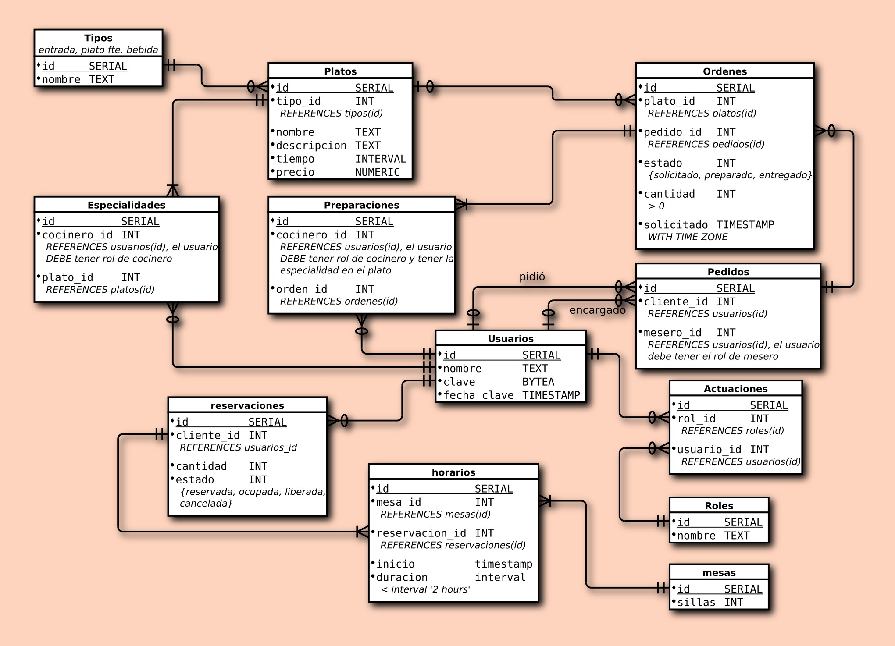

# Proyecto Restaurante: documentación

Bases de datos: Administración y Aplicaciones. Pontificia Universidad Javeriana. Ing. Ricardo Naranjo Faccini, M.Sc.

Este documento describe el diseño de la base de datos, los casos de uso, los tablespaces, las particiones y las consultas SQL, como pide el PDF en su sección 7. Las decisiones que el enunciado dejaba abiertas están en [decisiones.md](decisiones.md), los resultados de las pruebas en [resultados_pruebas.md](resultados_pruebas.md) y la comprobación de cada requisito en [auditoria_final.md](auditoria_final.md).

## 1. Descripción general

El sistema gestiona las mesas, las reservaciones, el menú, los pedidos y las entregas de un restaurante. Garantiza por medio de la base de datos que:

- no se supere el cupo del restaurante;
- no se crucen las reservaciones en una misma mesa;
- a cada cocinero solo le lleguen los platos que sabe preparar;
- los meseros registren y entreguen los pedidos de los clientes.

Tecnologías, todas instaladas en la máquina virtual del curso: PostgreSQL 13, PHP 8.0 con la extensión `pgsql`, Apache y la plantilla PHP entregada para el curso, sin frameworks ni dependencias adicionales.

### Organización de los archivos

| Ruta | Contenido |
|---|---|
| `sql/` | Scripts numerados en el orden de ejecución (sección 10) |
| `index.php`, `esqueleto.html`, `etc/`, `css/`, `lib/libreria.php`, `lib/restaurante.php`, `lib/programa.js` | Archivos de la plantilla, con los cambios indicados en la sección 9 |
| `lib/sesion.php` | Inicio y cierre de sesión, comprobación de roles |
| `lib/administrador.php`, `lib/maitre.php`, `lib/mesero.php`, `lib/cocinero.php` | Pantallas de cada rol |
| `pruebas/` | Pruebas automáticas y sus resultados |
| `docs/` | Esta documentación |

## 2. Diagrama entidad-relación

El PDF obliga a usar este diagrama. Se implementó sin agregar tablas, columnas ni relaciones.



Lectura del diagrama:

- **Personas.** `usuarios` guarda a empleados y clientes. Lo que cada uno puede hacer depende de sus `roles`, asignados por medio de `actuaciones`, de modo que un usuario podría tener varios roles sin repetir sus datos.
- **Menú.** Cada plato de `platos` pertenece a una categoría de `tipos`. `especialidades` indica qué platos sabe preparar cada cocinero.
- **Reservaciones.** Una reservación de `reservaciones` es de un cliente y se concreta en `horarios`, uno por cada mesa asignada. Así una reservación grande puede usar varias `mesas`.
- **Pedidos.** Un pedido de `pedidos` une a un cliente con su mesero y contiene `ordenes`, una por plato. `preparaciones` registra qué cocinero preparó cada orden.

**Normalización.** Las tablas están en tercera forma normal. Por ejemplo, el nombre de la categoría solo está en `tipos`, el precio solo en `platos` y el cupo total no se guarda: se calcula sumando `mesas.sillas`. El estado de un pedido tampoco se guarda: se deriva de sus órdenes en la vista `pedidos_detalle`.

**Diferencias físicas con el diagrama.**

- La clave primaria de `horarios` es `(id, inicio)` en lugar de `id`, porque PostgreSQL exige que la clave primaria de una tabla particionada incluya la columna de partición. Un trigger conserva `id` único en toda la tabla, de modo que el comportamiento lógico es el del diagrama.
- `usuarios.clave` y `usuarios.fecha_clave` admiten nulos, porque los clientes no inician sesión. El diagrama no explica si su punto "•" significa obligatorio.

## 3. Diccionario de datos

Comprobado contra el catálogo de PostgreSQL de la base `restaurante_proyecto`, que se guarda en `pruebas/resultados/04_catalogo.txt`. Todas las columnas son obligatorias (`NOT NULL`), salvo `usuarios.clave` y `usuarios.fecha_clave`.

### tipos: categorías del menú

| Columna | Tipo | Regla | Descripción |
|---|---|---|---|
| id | SERIAL | PK | Identificador |
| nombre | TEXT | UNIQUE; entrada, plato fuerte, postre o bebida | Nombre de la categoría |

### platos: ítems del menú

| Columna | Tipo | Regla | Descripción |
|---|---|---|---|
| id | SERIAL | PK | Identificador |
| tipo_id | INTEGER | FK a tipos(id) | Categoría del plato |
| nombre | TEXT | UNIQUE | Nombre del plato |
| descripcion | TEXT | | Descripción del plato |
| tiempo | INTERVAL | Mayor que 0 | Tiempo de preparación |
| precio | NUMERIC | Mayor o igual que 0 y distinto de `NaN` | Precio actual |

### especialidades: platos que sabe preparar cada cocinero

| Columna | Tipo | Regla | Descripción |
|---|---|---|---|
| id | SERIAL | PK | Identificador |
| cocinero_id | INTEGER | FK a usuarios(id); debe tener rol cocinero | Cocinero |
| plato_id | INTEGER | FK a platos(id); UNIQUE con cocinero_id | Plato |

### usuarios: empleados y clientes

| Columna | Tipo | Regla | Descripción |
|---|---|---|---|
| id | SERIAL | PK | Identificador |
| nombre | TEXT | No vacío | Nombre de la persona |
| clave | BYTEA | Admite nulo; nula junto con fecha_clave | Hash de `password_hash()` de PHP. Los clientes no inician sesión y no la tienen |
| fecha_clave | TIMESTAMP | Admite nulo | Fecha en que se asignó la clave |

### roles y actuaciones: qué rol tiene cada usuario

| Tabla.columna | Tipo | Regla | Descripción |
|---|---|---|---|
| roles.id | SERIAL | PK | Identificador |
| roles.nombre | TEXT | UNIQUE | administrador, maitre, mesero, cocinero o cliente |
| actuaciones.id | SERIAL | PK | Identificador |
| actuaciones.rol_id | INTEGER | FK a roles(id) | Rol asignado |
| actuaciones.usuario_id | INTEGER | FK a usuarios(id); UNIQUE con rol_id | Usuario |

### mesas

| Columna | Tipo | Regla | Descripción |
|---|---|---|---|
| id | SERIAL | PK | Identificador único de la mesa |
| sillas | INTEGER | Mayor que 0 | Número de asientos |

### reservaciones

| Columna | Tipo | Regla | Descripción |
|---|---|---|---|
| id | SERIAL | PK | Identificador |
| cliente_id | INTEGER | FK a usuarios(id) | Cliente |
| cantidad | INTEGER | Mayor que 0 | Número de personas |
| estado | INTEGER | 0 a 3; por omisión 0 | 0 reservada, 1 ocupada, 2 liberada, 3 cancelada |

### horarios: mesa y hora de cada reservación (tabla particionada)

| Columna | Tipo | Regla | Descripción |
|---|---|---|---|
| id | SERIAL | PK con inicio; único por trigger | Identificador |
| mesa_id | INTEGER | FK a mesas(id) | Mesa asignada |
| reservacion_id | INTEGER | FK a reservaciones(id) | Reservación |
| inicio | TIMESTAMP | PK con id; clave de partición | Hora de inicio |
| duracion | INTERVAL | Mayor que 0 y menor que 2 horas | Duración personalizable |

### pedidos

| Columna | Tipo | Regla | Descripción |
|---|---|---|---|
| id | SERIAL | PK | Identificador |
| cliente_id | INTEGER | FK a usuarios(id) | Cliente que pidió |
| mesero_id | INTEGER | FK a usuarios(id); debe tener rol mesero | Mesero encargado |

### ordenes: platos de un pedido

| Columna | Tipo | Regla | Descripción |
|---|---|---|---|
| id | SERIAL | PK | Identificador |
| plato_id | INTEGER | FK a platos(id) | Plato pedido |
| pedido_id | INTEGER | FK a pedidos(id) | Pedido |
| estado | INTEGER | 0 a 2; por omisión 0 | 0 solicitado, 1 preparado, 2 entregado. En pantalla: En preparación, Listo, Entregado |
| cantidad | INTEGER | Mayor que 0 | Unidades |
| solicitado | TIMESTAMP WITH TIME ZONE | Por omisión now() | Momento de la solicitud |

### preparaciones: quién preparó cada orden

| Columna | Tipo | Regla | Descripción |
|---|---|---|---|
| id | SERIAL | PK | Identificador |
| cocinero_id | INTEGER | FK a usuarios(id); rol cocinero y especialidad en el plato | Cocinero |
| orden_id | INTEGER | FK a ordenes(id); UNIQUE con cocinero_id | Orden preparada |

## 4. Relaciones

| Relación | Cardinalidad | Clave foránea | Al borrar el padre |
|---|---|---|---|
| tipos a platos | 1 a muchos | fk_platos_tipo | Se impide |
| platos a especialidades | 1 a muchos | fk_especialidades_plato | Se borran con él |
| usuarios (cocinero) a especialidades | 1 a muchos | fk_especialidades_cocinero | Se borran con él |
| platos a ordenes | 1 a muchos | fk_ordenes_plato | Se impide |
| pedidos a ordenes | 1 a muchos | fk_ordenes_pedido | Se impide |
| ordenes a preparaciones | 1 a muchos | fk_preparaciones_orden | Se impide |
| usuarios (cocinero) a preparaciones | 1 a muchos | fk_preparaciones_cocinero | Se impide |
| usuarios (cliente) a pedidos, "pidió" | 1 a muchos | fk_pedidos_cliente | Se impide |
| usuarios (mesero) a pedidos, "encargado" | 1 a muchos | fk_pedidos_mesero | Se impide |
| usuarios a actuaciones | 1 a muchos | fk_actuaciones_usuario | Se borran con él |
| roles a actuaciones | 1 a muchos | fk_actuaciones_rol | Se impide |
| usuarios (cliente) a reservaciones | 1 a muchos | fk_reservaciones_cliente | Se impide |
| reservaciones a horarios | 1 a muchos | fk_horarios_reservacion | Se impide |
| mesas a horarios | 1 a muchos | fk_horarios_mesa | Se impide |

Las relaciones "muchos a muchos" del diagrama se resuelven con tablas intermedias: cocineros y platos con `especialidades`; usuarios y roles con `actuaciones`; reservaciones y mesas con `horarios`.

Impedir el borrado conserva el historial: un plato ya pedido, una mesa usada o un empleado con pedidos no se pueden eliminar.

## 5. Restricciones

### Claves y reglas declarativas (`sql/01` a `sql/03`)

- **Claves primarias:** una por tabla, sobre `id`, y `(id, inicio)` en `horarios`.
- **Claves foráneas:** las 14 de la sección 4.
- **UNIQUE:** `uq_roles_nombre`, `uq_tipos_nombre`, `uq_platos_nombre`, `uq_actuaciones_usuario_rol`, `uq_especialidades_cocinero_plato`, `uq_preparaciones_orden_cocinero`.
- **CHECK:**

| Restricción | Regla |
|---|---|
| ck_usuarios_nombre_no_vacio | El nombre no puede estar vacío |
| ck_usuarios_clave_fecha_juntas | `clave` y `fecha_clave` son nulas a la vez o ninguna lo es |
| ck_tipos_categoria | Solo entrada, plato fuerte, postre o bebida |
| ck_platos_precio_valido | `precio >= 0` y distinto de `NaN` |
| ck_platos_tiempo_positivo | `tiempo > 0` |
| ck_mesas_sillas_positivas | `sillas > 0` |
| ck_reservaciones_cantidad_positiva | `cantidad > 0` |
| ck_reservaciones_estado | `estado` entre 0 y 3 |
| ck_ordenes_cantidad_positiva | `cantidad > 0` |
| ck_ordenes_estado | `estado` entre 0 y 2 |
| ck_horarios_duracion | `duracion` mayor que 0 y menor que 2 horas |

### Triggers y funciones (`sql/04_funciones_triggers.sql`)

| Trigger | Tabla | Cuándo | Qué garantiza |
|---|---|---|---|
| tr_horarios_bloquear_agenda | horarios | Antes de escribir | Toma el bloqueo de agenda. Por su nombre corre primero, porque PostgreSQL ejecuta los triggers en orden alfabético |
| tr_horarios_proteger | horarios | Antes de escribir | No se alteran horarios con pedidos ni de reservaciones finalizadas |
| tr_horarios_validar_inmediato | horarios | Después de insertar o cambiar | `id` único en toda la tabla; sin cruces en la mesa; el cupo no se supera en la ventana afectada |
| tr_horarios_reservacion_diferida | horarios | Al confirmar | Toda reservación activa termina con al menos un horario y sillas suficientes |
| tr_reservaciones_validar | reservaciones | Antes de escribir | Transiciones de estado válidas; no se cancela una reservación con pedidos |
| tr_reservaciones_activa_diferida | reservaciones | Al confirmar | Vuelve a validar sillas y cupo con la cantidad nueva |
| tr_mesas_bloquear_cambio_sillas | mesas | Antes de cambiar sillas | Toma el bloqueo de agenda |
| tr_mesas_validar_sillas | mesas | Después de cambiar sillas | Las reservaciones siguen cabiendo y el cupo no se supera |
| tr_especialidades_rol | especialidades | Antes de escribir | Solo un cocinero recibe especialidades |
| tr_pedidos_rol_mesero | pedidos | Antes de escribir | El encargado tiene rol de mesero |
| tr_pedidos_proteger_cliente | pedidos | Antes de cambiar el cliente | No cambia si el pedido ya tiene órdenes |
| tr_ordenes_validar | ordenes | Antes de escribir | Hay reservación vigente al pedir; estados 0 a 1 a 2 sin retroceder; preparada exige preparación; una orden ya preparada no se edita |
| tr_preparaciones_comprobar | preparaciones | Antes de escribir | Rol de cocinero, especialidad en el plato y orden aún solicitada |
| tr_preparaciones_proteger_finalizadas | preparaciones | Antes de cambiar o borrar | No se altera la preparación de una orden ya preparada |
| tr_actuaciones_proteger_historial | actuaciones | Antes de cambiar o borrar | No se quita un rol que tiene historial |

Funciones de apoyo: `tiene_rol`, `validar_cupo_ventana`, `validar_cupo_agenda`, `validar_sillas_reservacion`, `validar_cruce_horario`, `horario_tiene_pedidos` y `mesa_de_pedido`. Las demás son las funciones que ejecutan los triggers anteriores.

**Concurrencia.** Dos personas podrían reservar a la vez la última mesa libre, sin que ninguna transacción vea a la otra. Para evitarlo, todo lo que cambia la agenda toma primero un bloqueo global: `pg_advisory_xact_lock(2026110501)`. Las transacciones se atienden una a una y el bloqueo se libera al terminar cada una. Las funciones de validación son `VOLATILE`, aun las de solo lectura, para que en `READ COMMITTED` cada sentencia vea lo que otra sesión confirmó durante la espera. Se comprobó con sesiones simultáneas reales (`pruebas/02_concurrencia_volumen.sh`).

**Ventana de ocupación.** Una reservación ocupa su mesa en `[inicio, inicio + 2 horas)`, como pide el PDF para estimar la ocupación, aunque su `duracion` sea menor. A las 2 horas exactas la mesa ya está libre. Por eso ninguna regla usa `horarios.duracion`: el diagrama la exige y se conserva como la duración estimada que escribe el maitre.

**Relación entre cupo y sillas.** Si cada reservación cabe en sus mesas y las mesas no se cruzan, el cupo total no se puede superar: la suma de personas nunca excede la suma de sillas. El PDF pide validar el cupo de todos modos, así que se valida primero y con su propio mensaje. Se ve al pedir más personas que el cupo total, aun marcando todas las mesas.

### Vista

`pedidos_detalle` agrega a cada pedido la mesa, la hora de la primera orden y el estado derivado: entregado si todas sus órdenes lo están, listo si todas están preparadas o entregadas, y en preparación en otro caso. No se usó una columna `pedidos.mesa_id` porque el diagrama no la tiene: la mesa se deriva de la reservación del cliente, como acordó [decisiones.md](decisiones.md), sección 4.

### Índices

Además de los que crean las claves primarias y UNIQUE:

| Tabla | Índice | Columnas |
|---|---|---|
| actuaciones | ix_actuaciones_rol_id | rol_id |
| platos | ix_platos_tipo_id | tipo_id |
| especialidades | ix_especialidades_plato_id | plato_id |
| reservaciones | ix_reservaciones_cliente_estado | cliente_id, estado |
| reservaciones | ix_reservaciones_estado | estado |
| horarios | ix_horarios_id | id |
| horarios | ix_horarios_inicio | inicio |
| horarios | ix_horarios_mesa_inicio | mesa_id, inicio |
| horarios | ix_horarios_reservacion_id | reservacion_id |
| pedidos | ix_pedidos_cliente_id | cliente_id |
| pedidos | ix_pedidos_mesero_id | mesero_id |
| ordenes | ix_ordenes_plato_id | plato_id |
| ordenes | ix_ordenes_pedido_solicitado | pedido_id, solicitado |
| preparaciones | ix_preparaciones_cocinero_id | cocinero_id |
| preparaciones | ix_preparaciones_orden_id | orden_id |

## 6. Tablespaces y directorios físicos

El PDF pide al menos 2 espacios de trabajo en directorios diferentes. Se usan 3, que ya existían en la máquina virtual y se reutilizaron sin borrarlos. Su nombre es histórico: hoy almacenan `horarios`.

| Tablespace | Directorio físico | Partición |
|---|---|---|
| ts_reservaciones_1 | `/var/lib/pgsql/tablespaces/reservaciones_1` | horarios_1 |
| ts_reservaciones_2 | `/var/lib/pgsql/tablespaces/reservaciones_2` | horarios_2 |
| ts_reservaciones_3 | `/var/lib/pgsql/tablespaces/reservaciones_3` | horarios_3 |

Las demás tablas usan el tablespace por omisión de la base.

Consulta para comprobarlo:

```sql
SELECT c.relname, t.spcname, pg_tablespace_location(t.oid)
  FROM pg_class c
  JOIN pg_tablespace t ON t.oid = c.reltablespace
 WHERE c.relispartition
 ORDER BY c.relname;
```

## 7. Particionamiento

`horarios` se particiona por rango de fechas sobre `inicio` (`PARTITION BY RANGE (inicio)`), en `sql/03_tablespaces_particiones.sql`.

| Partición | Desde | Hasta (sin incluir) |
|---|---|---|
| horarios_1 | MINVALUE | 2026-10-01 |
| horarios_2 | 2026-10-01 | 2027-01-01 |
| horarios_3 | 2027-01-01 | MAXVALUE |

**Por qué `horarios`.** Solo tres columnas del modelo son fechas: `usuarios.fecha_clave`, `ordenes.solicitado` y `horarios.inicio`. PostgreSQL exige que la clave primaria de una tabla particionada incluya la columna de partición. Otras tablas apuntan con claves foráneas al `id` de `usuarios` y de `ordenes`, y dejarían de ser posibles. Ninguna tabla apunta a `horarios`.

**Consecuencias:**

- PostgreSQL ubica cada horario en su partición automáticamente. Si cambia de fecha, se mueve de partición, lo que se comprobó en las pruebas.
- Una consulta filtrada por `inicio` solo lee las particiones necesarias.
- PostgreSQL no admite `EXCLUDE` en este caso, por lo que los cruces se validan con trigger y bloqueo.

Consulta para ver cuántos horarios hay en cada partición:

```sql
SELECT tableoid::regclass AS particion, COUNT(*)
  FROM horarios
 GROUP BY 1
 ORDER BY 1;
```

## 8. Casos de uso

### Roles

Los empleados inician sesión eligiendo su nombre y escribiendo su clave. Cada uno ve solo las opciones de su rol, y la comprobación se repite en cada petición. Los clientes no entran al sistema: reservan por medio del maitre y piden por medio del mesero.

| Rol | Opciones | Archivo |
|---|---|---|
| Administrador | Mesas, Administrar menú, Empleados, Especialidades, Reportes, Historial | `lib/administrador.php` |
| Maitre | Reservaciones, Nueva reservación, Disponibilidad, Modificar | `lib/maitre.php` |
| Mesero | Realizar Pedido, Pedidos | `lib/mesero.php` |
| Cocinero | Órdenes | `lib/cocinero.php` |

### Casos del PDF

| Caso | Quién | Cómo se hace | Qué valida el sistema |
|---|---|---|---|
| 3.1 Gestión de mesas | Administrador | Mesas: agregar, cambiar sillas, eliminar | Sillas positivas; cupo total calculado; reducir sillas no puede dejar sin cupo a una reservación; una mesa con historial no se elimina |
| 3.2 Gestión de reservaciones | Maitre | Nueva reservación, Disponibilidad, Reservaciones, Modificar | Sin cruces en la mesa; cupo sin superar en ninguna hora con ocupación de 2 horas; sillas suficientes; transiciones de estado; lo que ya tiene pedidos no se mueve ni se cancela |
| 3.3 Gestión del menú | Administrador | Administrar menú: agregar, modificar, eliminar. La lista sale ordenada por categoría | Nombre único; precio y tiempo válidos; un plato ya pedido no se elimina |
| 3.4 Registro de pedidos | Mesero | Realizar Pedido: elegir una mesa con reservación vigente y las cantidades de varios platos | Reservación vigente en la mesa; el pedido queda con el cliente de esa mesa y el mesero de la sesión |
| 3.5 Gestión de entregas | Mesero | Aviso de órdenes listas, con la mesa y un botón Entregar orden por cada una | Solo órdenes listas y de sus pedidos |
| 3.6 Reportes | Administrador | Reportes: periodo y rango de fechas, por omisión desde el 1 de enero hasta hoy | Reservaciones y ventas por día, semana o mes; platos más solicitados |

### Funcionalidades adicionales del PDF

| Sección | Cómo se cumple |
|---|---|
| 4.1 Notificaciones | El bloque de avisos se actualiza solo cada 30 segundos desde `lib/programa.js`. El mesero lo ve en Pedidos y en el formulario de pedido; el maitre, en todas sus pantallas, con las reservaciones que comienzan en los próximos 30 minutos, valor configurable en `etc/parametros.php`. Se calculan por consulta y solo aparecen con la página abierta |
| 4.2 Gestión de empleados | Empleados: registrar, cambiar nombre o clave y eliminar maitres, meseros y cocineros |
| 4.3 Historial de clientes | Historial: todas las reservaciones y órdenes de cada cliente |
| 4.4 Validación de cupo | Triggers de `horarios`, `reservaciones` y `mesas` |
| 4.5 Interfaz por rol | Menú con las opciones de cada rol, mensajes de error en español y botones solo para acciones permitidas |
| Sección 2, cocineros | Especialidades: asignar platos a cada cocinero. Órdenes: solo sus especialidades, las más demoradas primero, con botón Marcar listo |

## 9. Consultas SQL y su función

`sql/06_consultas.sql` contiene las consultas de cada caso de uso, con su referencia al PDF. La aplicación ejecuta estas mismas consultas con parámetros (`$1`, `$2`). El script termina con las operaciones de escritura de cada caso dentro de una transacción que se revierte, de modo que se puede ejecutar sin cambiar los datos. Las validaciones diferidas también se fuerzan antes de revertir.

| PDF | Consulta | Función | Usada en |
|---|---|---|---|
| 3.1 | Mesas con `SUM(sillas) OVER ()` | Mesas y cupo total | `fn_admin_mesas` |
| 3.2 | Clientes registrados | Lista para elegir el cliente de una reservación | `clientes_registrados` |
| 3.2 | `WITH momento, capacidad, instantes, ocupaciones...` | Mesas libres alrededor de un instante y cupo máximo ocupado en las 2 horas siguientes | `consultar_disponibilidad` |
| 3.2 | Reservaciones del día | Reservaciones con horario en un día, con cliente, estado y mesas | `reservaciones_del_dia` |
| 3.3 | Platos con su categoría | Menú ordenado por categoría | `fn_admin_menu` |
| Plantilla | Carta de platos | Opción Desplegar Menu | `fn_desplegar_menu` |
| Plantilla | Mesas vigentes | Opción Realizar Pedido: mesas con una reservación activa ahora | `fn_realizar_pedidos` |
| 4.2 | Empleados con `string_agg` de roles | Lista de maitres, meseros y cocineros | `fn_admin_empleados` |
| 2 | Especialidades de un cocinero | Platos que sabe preparar. La pantalla solo usa `plato_id` para marcar las casillas | `fn_admin_especialidades` |
| 3.4 | Reservación vigente de una mesa | Cliente que ocupa la mesa ahora | `reservacion_vigente_de_mesa` |
| 3.4 | Pedidos del mesero | Pendientes o de hoy, con mesa y estado derivados | `fn_mesero_pedidos` |
| 3.4 | Órdenes de un pedido | Platos, cantidades, hora y estado | `ordenes_de_pedido` |
| 2 | Órdenes pendientes del cocinero | Solo sus especialidades, `ORDER BY p.tiempo DESC` | `fn_cocinero_ordenes` |
| 3.5 y 4.1 | Órdenes listas del mesero | Aviso de órdenes para entregar, con su mesa | `fn_mesero_avisos` |
| 4.1 | Reservaciones próximas | Aviso al maitre | `aviso_reservaciones_html` |
| 3.6 | Reservaciones por periodo | `date_trunc` sobre el primer inicio, sin canceladas | `fn_admin_reportes` |
| 3.6 | Platos más solicitados | `SUM(cantidad)` por plato | `fn_admin_reportes` |
| 3.6 | Ventas por periodo | `cantidad × precio` de órdenes entregadas | `fn_admin_reportes` |
| 4.3 | Historial del cliente | Reservaciones y órdenes, las más recientes primero | `fn_admin_historial` |

Las consultas de la plantilla se conservaron en `fn_desplegar_menu` y `fn_realizar_pedidos`. A la segunda se le cambió el filtro, para listar solo las mesas con una reservación activa vigente en este momento.

### Cambios a la plantilla

| Archivo | Cambio | Motivo |
|---|---|---|
| `index.php` | Parámetros de cookie de sesión, zona horaria, `session_start()`, inclusión de archivos nuevos y contraseña en la conexión | La máquina virtual exige contraseña en TCP; las pantallas por rol necesitan sesión |
| `lib/libreria.php` | `pg_conectar` recibe la contraseña; funciones auxiliares agregadas debajo | `Mostrar` y `procesar_query` quedan idénticas al original |
| `lib/restaurante.php` | `fn_menu_opciones` agrega los accesos por rol; `fn_desplegar_menu` y `fn_realizar_pedidos` escapan los datos; `fn_realizar_pedidos` lista las mesas con reservación vigente, muestra la hora y llama a `pedido_mesa` | Casos 3.4 y 4.5 |
| `etc/parametros.php` | Base `restaurante_proyecto` y plazo del aviso al maitre | Casos 4.1 y conexión |
| `css/estilo.css` | Reglas agregadas al final para tablas, formularios y mensajes | Interfaz por rol |
| `lib/programa.js` | Actualización periódica del bloque de avisos | Notificaciones 4.1 |

## 10. Instrucciones de ejecución

### Orden de los scripts

| Orden | Script | Qué hace | Quién lo ejecuta |
|---|---|---|---|
| 0 | `sql/00_preparacion_administrador.sql` | Crea la base y da permiso sobre los tablespaces. Se ejecuta una sola vez. En un servidor nuevo, primero hay que crear los directorios y quitar el comentario a sus `CREATE TABLESPACE`; esa ruta no se probó, porque en la máquina virtual ya existían | Administrador de PostgreSQL |
| 1 | `sql/01_estructura.sql` | Tablas, salvo `horarios` | `estudiante` |
| 2 | `sql/02_restricciones.sql` | CHECK, UNIQUE, claves foráneas e índices | `estudiante` |
| 3 | `sql/03_tablespaces_particiones.sql` | `horarios`, particiones y sus índices | `estudiante` |
| 4 | `sql/04_funciones_triggers.sql` | Funciones, triggers y vista | `estudiante` |
| 5 | `sql/05_datos.sql` | Datos de prueba. Se puede repetir: borra y carga de nuevo | `estudiante` |
| 6 | `sql/06_consultas.sql` | Consultas de cada caso de uso. No cambia datos | `estudiante` |

`sql/reconstruir.sql` ejecuta los pasos 1 a 4. Solo funciona sobre la base `restaurante_proyecto` y **borra todo su esquema**.

### Reconstruir la base en la máquina virtual

Desde la carpeta del proyecto, con el usuario `estudiante`:

```bash
psql -d restaurante_proyecto -f sql/reconstruir.sql
```

```bash
psql -d restaurante_proyecto -f sql/05_datos.sql
```

```bash
psql -d restaurante_proyecto -f sql/06_consultas.sql
```

La hora de los datos de hoy depende del momento de la carga. **Antes de una demostración, vuelva a cargar `sql/05_datos.sql`**, para que haya mesas ocupadas y reservaciones próximas a comenzar. Por el mismo motivo, los totales de reservaciones y pedidos varían levemente de una carga a otra.

### Datos de prueba

Son ficticios: 53 usuarios (1 administrador, 2 maitres, 5 meseros, 5 cocineros y 40 clientes), 15 mesas con 72 sillas, 24 platos, unas 525 reservaciones y unas 980 órdenes, repartidas en las tres particiones.

Todos los empleados de prueba usan la clave `restaurante2026`:

| Rol | Empleado |
|---|---|
| Administrador | Aurelia Pardo |
| Maitre | Marleny Cárdenas, Jhonatan Rincón |
| Mesero | Brayan Quintero, Leidy Mosquera, Yeison Ocampo, Mónica Téllez, Wilmer Buitrago |
| Cocinero | Yulieth Arboleda, Fabio Chacón, Nidia Cifuentes, Harold Patiño, Sonia Guarín |

### Abrir la aplicación

La aplicación está en la máquina virtual, en `~/public_html/restaurante`, y se abre en `http://10.43.98.50/~estudiante/restaurante/`. Requiere la VPN de la universidad. Si la red corta las conexiones HTTP directas, se puede abrir un túnel:

```bash
ssh -N -L 8080:localhost:80 estudiante@10.43.98.50
```

Y luego abrir `http://localhost:8080/~estudiante/restaurante/`.

La contraseña de la base está en `etc/parametros.php` de la máquina virtual. La copia de este repositorio la deja vacía a propósito.

### Ejecutar las pruebas

Deben ejecutarse en la máquina virtual, desde la carpeta del proyecto y en este orden. **Reconstruir borra los datos de `restaurante_proyecto`.** La prueba de integridad necesita la base vacía y revierte todo lo que hace. Las otras dos reconstruyen o cambian los datos y, al terminar, vuelven a cargar `sql/05_datos.sql`.

```bash
psql -d restaurante_proyecto -f sql/reconstruir.sql
```

```bash
psql -d restaurante_proyecto -f pruebas/01_integridad.sql
```

```bash
bash pruebas/02_concurrencia_volumen.sh --confirmar-borrado
```

```bash
bash pruebas/03_aplicacion.sh --confirmar-borrado
```

`pruebas/04_catalogo.sql` no es una prueba: lista lo que hay en el catálogo de PostgreSQL, para comparar la documentación con la base real. No cambia datos.

```bash
psql -d restaurante_proyecto -f pruebas/04_catalogo.sql
```

`pruebas/05_instalacion_limpia.sh` prueba la instalación en un servidor nuevo: ejecuta `sql/00`, `sql/reconstruir.sql`, `sql/05_datos.sql` y `sql/06_consultas.sql` en un clúster temporal, que borra al terminar. No toca la base real. Requiere que `initdb` y `pg_ctl` estén en la ruta de comandos.

```bash
bash pruebas/05_instalacion_limpia.sh
```

## 11. Decisiones y limitaciones conocidas

Aceptadas por el dueño del proyecto y detalladas en [decisiones.md](decisiones.md):

- **Pedido con una sola mesa.** Si la reservación tiene varias mesas, el pedido queda asociado a la de menor número, porque el diagrama no guarda la mesa en `pedidos`.
- **Ventas con el precio actual.** El diagrama no guarda precios históricos: cambiar un precio altera las ventas pasadas.
- **Avisos solo con la página abierta.** No hay tablas de notificaciones ni servicios externos.
- **Cuatro categorías.** El PDF exige bebida, aunque la nota del diagrama solo menciona tres.
- **El maitre registra clientes nuevos.** El administrador solo registra empleados y, de otro modo, un cliente nuevo no podría reservar.
- **La frase del PDF sobre la solución del docente no aplica,** según indicó el dueño del proyecto. La base es la plantilla PHP.
- **`Realizar Pedido` lista las mesas sin pedir sesión,** porque así funciona la opción de la plantilla. Registrar un pedido sí exige sesión de mesero.

Confirmadas por el dueño del proyecto el 2026-11-08, en la sección 13 de [decisiones.md](decisiones.md):

- Quién actualiza cada estado del pedido: "listo" el cocinero y "entregado" el mesero.
- Lo que ya tiene pedidos no se mueve ni se cancela.
- Si el cliente pide algo después, se registra otro pedido.
- El rol de un empleado no se cambia.
- Reportes con rango de fechas, y sin contar las reservaciones canceladas.
- Realizar Pedido solo lista las mesas con reservación vigente.
- Las reglas de nombre único de los platos, precio distinto de `NaN` y prohibición de eliminar la propia cuenta.
- Limitaciones: plato sin especialista, reservación vieja sin cerrar, entrega desde el formulario de pedido, recarga de la página y zona horaria del servidor.

## 12. Uso de inteligencia artificial

El PDF, en su sección 9, exige usar inteligencia artificial. El proyecto se desarrolló con dos asistentes:

- **Codex (OpenAI)** escribió el modelo de datos, los scripts SQL y la primera versión de la aplicación.
- **Claude Code (Anthropic)** supervisó cada fase contra el PDF y el diagrama, instaló en la máquina virtual, escribió las pruebas de concurrencia y de la aplicación, y terminó la aplicación cuando Codex agotó su cuota, con la autorización del dueño del proyecto.

Como aclara el PDF, el estudiante es responsable de lo entregado y debe comprenderlo y sustentarlo.
